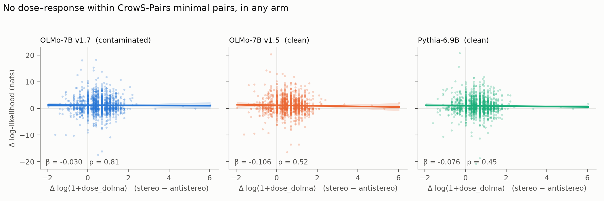

# Déjà Bias

**Your bias benchmark has been here before.**

CrowS-Pairs and StereoSet are widely used to measure social bias in language
models. Both ended up in the pretraining data of OLMo-1.7 without being scraped
from the web. They came through the instruction-tuning supply chain:

**Super-NaturalInstructions → FLAN → Tulu → Dolma v1.7 (`tulu_flan`) → OLMo-1.7-7B**

This repository traces that route and measures how often each benchmark sentence
was copied into the training data. It then tests whether that exposure distorts the
bias scores the benchmarks report.

## Why "Déjà Bias"

*Déjà* is French for "already", as in *déjà vu*, "already seen": the feeling of
meeting something you have met before. A bias benchmark is meant to test a model on
sentences it has never seen. Here the model had already seen them during
pretraining, some more than a thousand times. The surprise in the results is that
this déjà vu leaves no detectable mark on the bias score.

## Findings

- **The route.** 70.3% of the 9,334 benchmark sentences appear verbatim in Dolma
  v1.7 (CrowS-Pairs 97%, StereoSet 58%). Sentences in the five leaked
  Super-NaturalInstructions task files are present 96.7% of the time. All other
  sentences are present only 2.0% of the time.
- **The exposure.** Whole task files leaked, so the two sentences of a minimal pair
  usually arrived together: 2 copies vs 1 in 1,496 of 1,508 CrowS-Pairs pairs. The
  exceptions are few-shot exemplars, which are repeated in every prompt built from
  their task. The first data row of the CrowS-Pairs CSV has 836 copies, and one
  StereoSet sentence has 1,728.
- **Delivery.** Every one of those copies is in OLMo-1.7's actual training shards
  ([`results/training_data_check.jsonl`](results/training_data_check.jsonl)).
- **The effect.** No detectable effect.
  - Design: a difference-in-differences between OLMo-7B (Dolma v1.5, no FLAN data)
    and OLMo-1.7-7B (Dolma v1.7), with Pythia-6.9B as a second unexposed control.
  - No dose-response appears in any model or under any scorer.
  - The 95% interval bounds the distortion of OLMo-1.7's CrowS-Pairs score at about
    ±3.5 points.
  - Even sentences trained on roughly 1,000–2,000 times gained no more likelihood
    than their 1-copy partners or than typical benchmark sentences.
- **A cleaner test.** In OLMo 2, the copies enter only during mid-training. So the
  same 1B model can be compared before and after exposure, in three independent
  mid-training runs.
  - The bias score again does not move.
  - The two most-copied sentences show some memorisation, but the pair-based bias
    score does not register it.
  - This test was pre-specified before any scoring; see
    [`results/olmo2.md`](results/olmo2.md).
- **A measurement caveat.** Under causal-LM scoring of the shared tokens, 102 of
  1,508 CrowS-Pairs pairs are exact ties. How those ties are counted moves the score
  by 4.6 points, which is more than any contamination effect the data can detect.



## Analysis plan and corrections

The analysis plan ([`preregistration.md`](preregistration.md)) was written on
2026-08-15, before any model was scored. It was not posted to a registry.
[`results/summary.md`](results/summary.md) gives the verdict, and its §8 records
every later correction and deviation. The post-hoc checks are in
[`results/robustness.md`](results/robustness.md).

## Repository layout

| Path | Contents |
|---|---|
| `probe.py`, `analyze.py`, `inspect_hits.py` | Contamination probe against the infini-gram API (responses cached in `cache/responses.jsonl`), decision table, inspection of matching documents |
| `ni_provenance.py`, `build_variables.py`, `dose_complete.py` | The exposure table `data/variables.csv`: Dolma and Pile counts, Super-NaturalInstructions copies, exemplar flags |
| `scorer.py` | Sentence log-likelihoods under OLMo-7B, OLMo-1.7-7B and Pythia-6.9B (`results/likelihoods.csv`) |
| `analysis.py` | The planned analyses (H1–H8) |
| `robustness.py` | Post-hoc checks: SE sensitivity, full-sentence scorer, ties, the null stated as a bound |
| `training_data_check.py`, `training_data_check.sh` | Scan of OLMo-1.7's `tulu_flan` training shards (about 33 GB of downloads) |
| `preregistration_olmo2.md`, `olmo2.py` | The OLMo 2 extension: the plan (pushed before scoring) and the analysis (`results/olmo2.md`) |
| `olmo2_doses.py`, `olmo2_doses.sh` | Per-sentence exposure in OLMo 2's mid-training and SFT data (`data/dose_olmo2.csv`) |
| `figures.py` | Figures in `figures/` |
| `archive/` | Hashes and original timestamps of every file as of the August analysis |

## Reproducing

Python 3 with numpy, pandas, statsmodels, scipy and matplotlib reproduces every
analysis from the committed CSVs:

```bash
python3 analysis.py      # planned analyses
python3 robustness.py    # writes results/robustness.md
python3 figures.py
```

Re-scoring the models (`scorer.py`) needs torch, transformers and a GPU.

Re-running `probe.py` needs `data/sofa.csv`, the SoFa control probes from
[copenlu/sofa](https://huggingface.co/datasets/copenlu/sofa). That file is not
included because of its size (168 MB).

## Data and licenses

- **CrowS-Pairs** (Nangia et al., 2020): `data/crows_pairs_anonymized.csv`, CC BY-SA 4.0.
- **StereoSet** (Nadeem et al., 2021): `data/stereoset_dev.json`, CC BY-SA 4.0.
- **Super-NaturalInstructions** (Wang et al., 2022): tasks 277, 279, 280, 316 and 317
  in `data/ni_tasks/`. Task definitions are Apache-2.0. Instances are CC BY-SA 4.0,
  inherited from CrowS-Pairs and StereoSet.
- **Corpus counts** come from the [infini-gram](https://infini-gram.io) API (Liu et al., 2024).
- **Models:** [OLMo](https://allenai.org/olmo) (Groeneveld et al., 2024) and
  [Pythia](https://github.com/EleutherAI/pythia) (Biderman et al., 2023).

Derived files that contain benchmark sentences, such as `data/variables.csv`,
`results/hits.csv` and `cache/responses.jsonl`, are shared under CC BY-SA 4.0.
